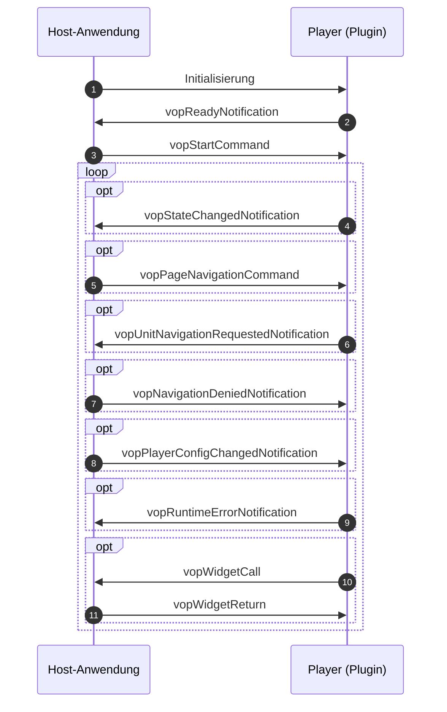

[](http://creativecommons.org/publicdomain/zero/1.0/)

This repo is part of the tba specifications and focuses on the specification of player plugin.

[Docs](https://iqb-specifications.github.io/concepts/plug-ins) (German only)

## release notes

Please see the [release section](https://github.com/iqb-specifications/plugin-player/releases) of this repository to learn about changes.

## For Contributors

This api is written as [async api](https://www.asyncapi.com/de) yaml file. After committing to main branch, a GitHub action is triggered to build the html page. Create an release with release notes.

For a human readable version of the spec [see here](https://iqb-specifications.github.io/plugin-player).

# Kommunikationsmodell



::: {#spec}

## 1 Initialisierung

Der Host richtet ein `<iframe>`-Element ein und setzt für das `srcdoc`-Attribut den kompletten Inhalt des Plugins. Das Plugin ist technisch eine Html-Seite, d. h. es wird durch das Laden auch die Ausführung von JavaScript-Code angestoßen, der auf oberster Ebene vorgesehen ist.

## 2 Ready Notification

Der Code zur Initialisierung sendet als letzten Schritt eine Nachricht an den Host, dass das Plugin bereit sei für das Start-Kommando. Als Payload wird das [Metadaten-Objekt](https://iqb-specifications.github.io/concepts/plugins/metadata.html) mitgeschickt -- hier allerdings als String serialisiert, um nicht bei jeder Änderung der Metadaten-Spezifikation alle Modul-API ändern zu müssen.

## 3 Start Command

> Ausführliche Darstellung des Start-Kommandos siehe [unten](#start-kommando).

Nachdem der Host die Bereitschaftsmeldung erhalten hat, schickt er die Unit-Definition: Parameter `unitDefinition`, serialisiert als String. Damit stellt der Player -- der nach der Initialisierung zunächst eine leere Seite zeigt -- alle Elemente dar, die in der Unit-Definition vorgesehen sind und bereitet die Interaktionselemente vor.

Dem Player wird mit `sessionId` eine Kennung mitgeschickt, die der Player anschließend in jeder Nachricht verwenden soll. Damit wird die korrekte Zuordnung der Nachricht bzw. der darin enthaltenen Daten zur Unit unterstützt.

Weitere Parameter:

* `unitDefinitionType`: Sollte es Varianten oder Versionen von Unit-Definitionen geben, kann dies hier dem Player mitgeteilt werden. Alternativ (oder parallel) kann natürlich diese Information als Teil der Datenstruktur der Unit-Definition übergeben werden.
* `unitState`: Sollte die Unit wiederholt präsentiert werden, soll der vorherige Bearbeitungsstatus wiederhergestellt werden. Weitere Erläuterungen zu diesem Datenobjekt finden Sie [hier](#unit-status).
* `playerConfig`: Hier werden Parameter übergeben, die die Anzeige und die Interaktion steuern. Beispielsweise kann die Art und Weise des Blätterns zur nächsten Seite festgelegt werden. Weitere Erläuterungen zu diesem Datenobjekt finden Sie [hier](#konfiguration-des-players).
 
## 4 State Changed Notification

> Ausführliche Darstellung der Meldung zur Statusänderung siehe [unten](#meldung-von-änderungen).

Sobald eine Interaktion stattgefunden hat, die als Antwort wichtig wäre oder die bei einem wiederholten Aufruf der Unit wiederhergestellt werden soll, meldet der Player diese Änderung. Parameter:

* `sessionId`: Die Kennung aus dem Start-Kommando, um die korrekte Zuordnung der Nachricht bzw. der darin enthaltenen Daten zur Unit zu unterstützen.
* `timeStamp`: Ein String im Standard-Format [date-time](https://tc39.es/ecma262/multipage/numbers-and-dates.html#sec-date-time-string-format). Die Nutzung dieser Information ist dem Host überlassen, soll aber vor allem die korrekte Reihenfolge vieler asynchron eintreffender Nachrichten sicherstellen.
* `unitState`: Daten der Antworten im weiteren Sinne. Diese dienen der Auswertung und der Wiederherstellung beim Zurückblättern. Weitere Erläuterungen zu diesem Datenobjekt finden Sie [hier](#unit-status).
* `playerState`: Hier schickt der Player Informationen, die dem Host helfen können, die UI anzupassen. Beispielsweise wird so ein Wechsel der Seite berichtet, damit der Host in der Navigationsdarstellung die aktive Seite anders darstellt (s. unten).
* `log`: Hierüber werden Log-Einträge geschickt. Dies sind Ereignisse, die nicht unbedingt einen Status ändern, sondern nur der Rekonstruktion der Beantwortung über die Zeit dienen können (s. unten).

## 5 Page Navigation Command

Über dieses Kommando kann der Host den Player anweisen, zu einer bestimmten Seite zu wechseln. Dies ist sinnvoll, wenn der Host eine Seitennavigation z. B. über eine Button-Leiste anbietet. Parameter:

* `sessionId`: Die Kennung aus dem Start-Kommando, um die korrekte Zuordnung der Nachricht bzw. der darin enthaltenen Daten zur Unit zu unterstützen.
* `target`: ID der Seite, zu der der Player navigieren soll. Die möglichen Seiten kennt der Host aus einer Nachricht `vopStateChangedNotification` des Players. Liegt eine solche Nachricht nicht vor, geht der Host davon aus, dass es nur eine Seite gibt und bietet keine Seitennavigation an.

## 6 Unit Navigation Requested Notification

Der Player kann Buttons einblenden, über die die Testperson zu einer anderen Unit navigiert. Eine Unit-Navigation kann auch über andere Bedingungen durch den Player ausgelöst werden, z. B. Ablauf einer Frist.

Über diese Nachricht fordert der Player eine Unit-Navigation an. Ob dann tatsächlich eine Unit-Navigation erfolgt, entscheidet der Host. Beispielsweise wird in der Voransicht einer Unit im Autorensystem IQB-Studio nur kurz eine Nachricht eingeblendet, dass eine Unit-Navigation angefordert wurde.

* `sessionId`: Die Kennung aus dem Start-Kommando, um die korrekte Zuordnung der Nachricht bzw. der darin enthaltenen Daten zur Unit zu unterstützen.
* `target`: Ziel-Unit. Dies ist allerdings keine ID einer konkreten Unit, sondern ein Symbol für eine relativ zur aktuellen Unit befindlichen Unit: `NEXT`, `PREVIOUS`, `FIRST`, `LAST`, `END`. Die möglichen Ziele kennt der Player aus dem Start-Kommando.

## 7 Navigation Denied Notification

Im Testablauf können fehlende oder falsche Antworten problematisch sein. Insbesondere bei Befragungen ist oft Vollständigkeit gewünscht. Daher meldet der Player bei einer Statusänderung auch diese Informationen mit. Der Testcontroller kann dann je nach Einstellung entscheiden, ob eine Navigation zur nächsten Unit zulässig ist oder nicht.

Sollte dies nicht der Fall sein, sollte der Player fehlende oder falsche Antworten visuell markieren. In normalen Formularen erfolgt dies, wenn der Eingabefokus auf ein Eingabeelement kommt und ohne weitere Eingabe zum nächsten Element wechselt. Aber wenn ein Eingabeelement nie den Fokus bekommt, kann die Fehlersituation nicht erzeugt werden. Die Alternative, alle Eingabeelemente beim Betreten der Unit als fehlerhaft darzustellen, wäre keine gute UI-Entscheidung.

Die Nachricht `vopNavigationDeniedNotification` des Hosts ist also als Aufforderung an den Player zu verstehen, fehlende oder falsche Eingaben visuell darzustellen. Technisch kann das bei Angular Material z. B. über `markAllAsTouched()` gehen. Parameter:

* `sessionId`: Die Kennung aus dem Start-Kommando, um die korrekte Zuordnung der Nachricht bzw. der darin enthaltenen Daten zur Unit zu unterstützen.
* `reason`: Hinweis für den Player, warum die Navigation verweigert wurde: `PRESENTATION_INCOMPLETE` und/oder `RESPONSES_INCOMPLETE`.

## 8 Player Config Changed Notification

Diese Nachricht soll den Player darüber informieren, dass sich die Konfiguration `playerConfig`, die das Modul im Startkommando erhalten hat, geändert hat. Beispiele:

* durch Antworten oder Zeitablauf ist die Liste der möglichen Navigationsziele erweitert
* der User kann das Einblenden von IDs im Print-Modus ein- und ausschalten im Host

Parameter:

* `sessionId`: Die Kennung aus dem Start-Kommando, um die korrekte Zuordnung der Nachricht bzw. der darin enthaltenen Daten zur Unit zu unterstützen.
* `playerConfig`: Bitte diese Datenstruktur [hier nachlesen](#konfiguration-des-players)

## 9 Runtime Error Notification

Diese Nachricht soll die Host-Anwendung darüber informieren, dass während der Ausführung von Code im Player ein Fehler aufgetreten ist, der die Beantwortung beeinträchtigen könnte. Die Interpretation ist dem Host überlassen. Sie reicht von Benachrichtigung des Users über die Freigabe der Navigation (presentationProgress verhindert normalerweise das Weiterblättern) bis zum Abbruch der Testung.

* `sessionId`: Die Kennung aus dem Start-Kommando, um die korrekte Zuordnung der Nachricht bzw. der darin enthaltenen Daten zur Unit zu unterstützen.
* `code`, `message`: Strings, die den Fehler beschreiben. Prinzipiell ist diese Liste offen, aber im IQB-Kontext werden [diese Codes](#fehlercodes) verwendet.


## 10 Widget Call

Es wird ein [Widget](https://iqb-specifications.github.io/concepts/plugins/widget.html) angefordert.

* `sessionId`: Die Kennung aus dem Start-Kommando, um die korrekte Zuordnung der Nachricht bzw. der darin enthaltenen Daten zur Unit zu unterstützen.
* `callId`: Sollte es in einer Unit mehrere Punkte geben, die das Widget anfordern könnten, muss hier eine ID übergeben werden. Dadurch kann dann beim korrespondierenden Return eine korrekte Zuordnung der erhaltenen Daten erfolgen.
* `widgetType`: Hier ist der Typ des Widgets anzugeben: `CALC` für einen virtuellen Taschenrechner, `PERIODIC_TABLE` für ein Periodensystem der Elemente, `MOLECULE_EDITOR` für einen Molekül-Editor.
* `parameters`: Einfache Liste von `key`/`value`-Paaren, die Varianten des Widgets steuern. Es könnte darüber beispielsweise eine bestimmte Funktionalität des Taschenrechners angefordert werden.
* `state`: Ein Zustand aus einem vorherige Aufruf des Widgets oder ein spezifischer Default-Wert kann die UX verbessern.

## 11 Widget Return

Nachdem ein Widget angefordert wurde, meldet diese Nachricht, dass das Widget wieder geschlossen wurde.

* `sessionId`: Die Kennung aus dem Start-Kommando, um die korrekte Zuordnung der Nachricht bzw. der darin enthaltenen Daten zur Unit zu unterstützen.
* `callId`: Sollte es in einer Unit mehrere Punkte geben, die das Widget anfordern könnten, wird hier die bei der Anforderung übergebene ID genannt.
* `state`: Der letzte Bearbeitungsstand des Widgets.

## Window Focus Changed Notification

In vorherigen Versionen der Schnittstelle war vorgesehen, dass der Player den Host über das Erhalten bzw. den Verlust des Fokus informiert. Das ist nicht mehr nötig, da jeder Host bei Bedarf einen Listener auf das `iframe`-Element setzen kann.

<details><summary>Code-Beispiel</summary>

```html

<div>Host Fokus: <p id="hostFocus"></p></div>
<div>Client Fokus: <p id="clientFocus"></p></div>

<iframe></iframe>

<script>
  const iframe = document.querySelector('iframe');
  const hostFocus = document.querySelector('#hostFocus');
  const clientFocus = document.querySelector('#clientFocus');
  iframe.setAttribute('srcdoc', '<div>click me</div>');

  iframe.contentWindow.addEventListener('blur', () => {
    clientFocus.innerText = 'no';
  });

  iframe.contentWindow.addEventListener('focus', () => {
    clientFocus.innerText = 'yes';
  });

  window.addEventListener('blur', () => {
    hostFocus.innerText = 'no';
  });

  window.addEventListener('focus', () => {
    hostFocus.innerText = 'yes';
  });
</script>

```
</details>


# Start-Kommando

Das Start-Kommando hat die Message-Id `vopStartCommand`. 

* `sessionId`: Dem Player wird mit `sessionId` eine Kennung mitgeschickt, die der Player anschließend in jeder Nachricht verwenden soll. Damit wird die korrekte Zuordnung der Nachricht bzw. der darin enthaltenen Daten zur Unit unterstützt. Diese ID ist wichtiger, wenn es mehrere Player pro Seite beim Host gibt, die gleichzeitig verwaltet werden sollen.

## UI-Definition der Unit

Die UI-Definition der Unit `unitDefinition` beschreibt das Erscheinungsbild der Unit und ggf. die Interaktionselemente.

> Beispiel: Bei einem Player für einen basalen Lesegeschwindigkeitstest besteht die Unit-Definition nur aus einem Text, der durch die Testperson gelesen werden soll, und dann soll einer von zwei Buttons geklickt werden -- "JA" oder "NEIN". So ein Text heißt z. B. "Eis ist warm". Als Antwort wird die Kennung des Buttons -- "A" oder "B" -- geliefert sowie die Zeit in Millisekunden, die von der Präsentation der Unit (entspricht der Bereitschaftsmeldung des Players) bis zum Klicken eines Buttons vergangen ist. Mit dem Klick wird auch gleich eine Anforderung für eine Unit-Navigation `NEXT` abgeschickt. Dieser spezialisierte Player benötigt aufgrund umfangreicher Konventionen nur den Text als Unit-Definition.

Häufig wird es sich bei der Unit-Definition um ein Datenobjekt handeln, das z. B. über `JSON.stringify()` serialisiert wurde. Die Komplexität der übergebenen Daten ist nicht bestimmbar und aus Sicht der Verona-Spezifikationen auch egal. Der Player wird die Datenstruktur wieder zu einem Datenobjekt transformieren, prüfen und auswerten.

## Typ

Der Typ der UI-Definition `unitDefinitionType` soll dem Player helfen, Missverständnisse bei der Interpretation der Unit-Definition zu vermeiden. Aus Sicht der Host-Anwendung ist es jedoch wichtiger, Namen und Version des erforderlichen Players zu kennen. Wenn bekannt ist, dass Player `XY@3.5` für diese Unit-Definition sinnvollerweise benutzt werden sollte, dann muss der Host diesen Player besorgen. Dann spielt der Typ der Unit-Definition eine untergeordnete Rolle.

## Unit-Status

Beim `unitState` handelt es sich um dasselbe Objekt, das der Player an den Host sendet, wenn sich der Status ändert. Wenn der Player diese Datenstruktur im Startkommando bekommt, stellt er einen vorherigen Bearbeitungsstand wieder her und meldet als neuen Status nur Abweichungen zu diesem Stand.

Grundsätzlich sind die Eigenschaften der Datenstruktur `unitState` optional. Es sollte nur das übergeben werden, was sich geändert hat.

### `dataParts`

Dies ist ein JSON-Objekt mit der Struktur `key-value`-store. Diese Datenstruktur ist auch bekannt als dictionary oder Hash-Tabelle.

```{.json filename="Beispiel dataParts"}
{
    "part1": "3456998",
    "part3": "{\"x\":[10,null,null,null]}"
}

```

Bei Änderungen muss jeweils nur der Datenteil geschickt werden, der sich geändert hat. Der Host muss dafür sorgen, dass nur dieser Teil überschrieben wird, die anderen Teile müssen erhalten bleiben. Dieses Vorgehen verhindert, dass bei jeder kleinen Änderung eine große Datenmenge geschickt wird und das System ausbremst.

Wenn der Unit-Status beim Start-Kommando zum Wiederherstellen geschickt wird, müssen natürlich alle Datenteile übergeben werden.

### `presentationProgress`

Bei Leistungstests ist es wichtig sicherzustellen, dass die Testperson alle Teile der Unit gesehen hat. Es muss keine Beantwortung erfolgen, aber ein unabsichtliches Auslassen ist problematisch für die Datenanalyse. Daher wird vom Player erwartet, dass er bei Änderungen der Anzeige prüft, ob alles gesehen wurde und dies berichtet. Dann kann ggf. die Teststeuerung ein Weiterblättern verhindern und einen Hinweis geben.

Mögliche Werte:

* `NONE`: Nichts wurde gesehen - Ausgangszustand
* `SOME`: Einige Bereiche der Unit wurden präsentiert
* `COMPLETE`: Alle Elemente/Bereiche wurde präsentiert

Der Stand der Präsentation wird beim Start-Kommando vom Host geschickt, so dass der Player nur die Änderung zu diesem Status berichtet.

### `responseProgress`

Bei Befragungen ist oft wichtig, dass die befragte Person keine Frage auslässt. Aber auch bei Leistungstests können zu Beginn Units vorgesehen werden, die Übungscharakter haben und die Testperson soll erst weiterkommen, wenn sie ein Mindestmaß an Antworten geben konnte. Daher wird vom Player erwartet, dass er während der Bearbeitung prüft, ob alle notwendigen Eingaben erfolgten und auch korrekt sind. Dann kann ggf. die Teststeuerung ein Weiterblättern verhindern und einen Hinweis geben.

Mögliche Werte:

* `NONE`: Nichts wurde beantwortet - Ausgangszustand
* `SOME`: Einige Antworten wurden gegeben
* `COMPLETE`: Alle Antworten wurden gegeben

> Hinweis Validierung: Eine Validierung kann problematisch sein, wenn Elemente eines Standard-Html-Formulars verwendet werden. Wenn als Typ eines `<input>`-Elementes beispielsweise eine Zahl gesetzt ist, dann wird eine Texteingabe nicht verfügbar. Die Validierung verhindert also den Zugriff auf fehlerhafte Eingaben.

> Hinweis "required": Ob eine Antwort als "erforderlich" -- also als "required" -- gewertet wird, sollte gezielt gesteuert werden. Das Player-Modul sollte "responses complete" nur für die als erforderlich markierten Elemente melden. Dann meldet der Player sofort nach Start der Unit "responses complete", wenn die Unit keine Elemente mit der Markierung "erforderlich" hat.

### `unitStateDataType`

Hier soll dem Host mitgeteilt werden, um welchen Datentyp es sich bei den Datenteilen `dataParts` handelt. Beispiel: `iqb-standard@1.2`. Ein Player kann also eine exotische, nicht dokumentierte Unit-Definition verwenden, erzeugt aber Antworten in einem dokumentierten Format.

## Konfiguration des Players

Die Property `playerConfig` beeinflusst in starkem Maße, wie der Player die Unit darstellt.

* `unitNumber`, `unitTitle`, `unitId`: Diese Angaben werden benötigt, wenn der Player den gesamten verfügbaren Bildschirm des Browsers einnehmen soll. Dann kann der Host keine Orientierung darüber geben, an welcher Stelle des Testablaufes die Testperson gerade ist und der Player muss dies übernehmen. Für diesen Fall sind diese Informationen gedacht.
* `logPolicy`: Aus einem Forschungsinteresse heraus könnte der Player angehalten sein, viele Zustandsänderungen an den Host zu melden. Das kann vom Scrollverhalten bis zum Mitschreiben Mausbewegungen gehen. Allerdings gibt es sehr viele Anwendungsfälle für das Player-Modul, wo dieses Logging abgestellt werden sollte. Beispiele: Review der Unit während der Qualitätsprüfung, Verwendung als Beispielaufgabe, Präsentation der Antworten zur manuellen Kodierung. Aus diesem Grund kann dem Player differenziert mitgeteilt werden, ob bzw. in welchem Maße Logs an den Host geschickt werden sollen: `DISABLED`, `LEAN`, `RICH`, `DEBUG`. Die Interpretation der Werte ist derzeit nicht festgelegt.
* `pagingMode`: Wenn die Unit aus mehreren Seiten besteht, wird über diesen Parameter festgelegt, ob bzw. wie das Blättern erfolgen soll. Dieses Verhalten sollte in einem Test einheitlich sein, so dass es kein fixer Parameter der Unit-Definition ist. Verschiedene Tests können unterschiedliches Blätter-Verhalten wünschen, ohne dass die Unit-Definition geändert werden muss. Mögliche Werte:
  * `SEPARATE`: Die Seiten werden einzeln angezeigt, so wie die Seitennavigation es steuert. Die Animation des Seitenwechsels ist horizontal.
  * `BUTTONS`: Die Seiten werden einzeln angezeigt, aber es werden Buttons eingeblendet, die auf weitere Seiten hinweisen und bei Klick eine Seitennavigation auslösen. Die Animation des Seitenwechsels ist vertikal.
  * `CONCAT_SCROLL`: Alle Seiten werden zu einer einzigen Seite zusammengelegt (gestapelt). Die Testperson scrollt vertikal und bemerkt nicht, dass es mehrere Seiten gibt. Sollte eine Seitennavigation aktiv sein, wird entsprechend gescrollt.
  * `CONCAT_SCROLL_SNAP`: Alle Seiten werden zu einer einzigen Seite zusammengelegt, jedoch ist stets nur eine Seite zu sehen. Die Testperson scrollt vertikal und die Seiten "schnappen" in den Sichtbereich, so dass nie zwei Seiten gleichzeitig zu sehen sind. Dieser Modus ist vorteilhaft, wenn die Zeit, die eine Testperson auf einer Seite verbringt, gemessen werden soll. Man erreicht eine intuitive Art des Seitenwechsels, verliert aber nicht die Information "time on page".

> Achtung: Scroll-snap ist nicht verlässlich. Der Scroll-snap-Modus beim Blättern ist eine standardisierte Html-Eigenschaft. Allerdings ist dieses Verhalten unterschiedlich implementiert in den Browsern bzw. Betriebssystemen. Vor der Nutzung sollten ausgiebige Tests sicherstellen, dass sich alle verwendeten Geräte wie gewünscht verhalten.

* `printMode`: Im Rahmen der Qualitätssicherung müssen Testaufgaben ausgiebig überprüft werden. Normalerweise begibt sich der Prüfer bzw. die Prüferin in die Rolle der Testperson und beantwortet Schritt für Schritt die Fragen. Dies kann allerdings sehr zeitaufwändig sein, insbesondere, wenn Audio-Sequenzen abgewartet werden müssen, bevor weitere Teile der Unit sichtbar werden.<br/>Um diesen Review zu erleichtern, kann der Player in den sog. Printmodus geschaltet werden. Der Host begrenzt dann das `<iframe>`-Element nicht mehr auf den Bildschirm, sondern gibt so viel Höhe, wie der Player für die Unit benötigt. Es werden alle Seiten untereinander gestapelt und alle Einschränkungen der Sichtbarkeit von Seiten bzw. Seitenabschnitten aufgehoben. Weiterhin kann der Player ein separates Styling (Markierung über `@media print`) für das Drucken aus dem Browser heraus bereitstellen. Mögliche Werte:
  * `OFF`: Kein Printmodus.
  * `ON`: Printmodus.
  * `ON_WITH_IDS`: Printmodus, und zusätzlich werden die IDs der Elemente der Unit eingeblendet.
  * `SELECTED_ELEMENTS_ONLY`: Wenn `elementsToHighlight` gesetzt sind, dann werden nur diese angezeigt und alle anderen Elemente werden ausgeblendet.
* `elementsToHighlight`: Hier kann eine Liste von (Basis-)Variablen übergeben werden, die der Player in geeigneter Weite hervorhebt (Ausgrauen des Rests, farbiger Rahmen u. ä.). Wenn zusätzlich bei `printMode` der Wert `SELECTED_ELEMENTS_ONLY` gesetzt ist, dann werden alle anderen Elemente ausgeblendet.
* `enabledNavigationTargets`: Diese einfache Liste von Strings informiert den Player, welche der fünf möglichen Ziele für die Unit-Navigation zur Verfügung stehen. Dann kann der Player beispielsweise den "Weiter"-Button ausblenden, wenn es keine weiteren Units gibt. Oder es wird der "Zurück"-Button ausgeblendet, wenn der Testperson grundsätzlich ein Zurückgehen nicht gestattet ist. Mögliche Werte: `NEXT`, `PREVIOUS`, `FIRST`, `LAST`, `END`.
* `startPage`: Sollte der Player sofort nach dem Start auf eine bestimmte Seite navigieren, kann dies hier angegeben werden. Dies ist beispielsweise bei der Anzeige von Units mit gegebenen Antworten bei der manuellen Kodierung gewünscht.
* `directDownloadUrl`: Sollte der Player während der Laufzeit Code nachladen müssen, kann aus Gründen der Datensicherheit nicht einfach irgendein Server genutzt werden. Dem Player muss mitgeteilt werden, welche URL dafür zulässig ist. Beispiel: GeoGebra.
* `sharedParameters`: Daten, die zur Laufzeit zwischen Player-Instanzen ausgetauscht werden sollen. Details siehe [hier](https://iqb-specifications.github.io/concepts/plugins/communication.html#gemeinsame-parameter-sharedparameters).


# Meldung von Änderungen

Die Message-Id für das Melden von Änderungen an den Host lautet `vopStateChangedNotification`.

* `sessionId`: Dem Player wurde im Start-Kommando eine `sessionId` eine Kennung mitgeschickt, die der Player anschließend in jeder Nachricht verwendet. Damit wird die korrekte Zuordnung der Nachricht bzw. der darin enthaltenen Daten zur Unit unterstützt.
* `timestamp`: Ein String im Standard-Format [date-time](https://tc39.es/ecma262/multipage/numbers-and-dates.html#sec-date-time-string-format). Die Nutzung dieser Information ist dem Host überlassen, soll aber vor allem die korrekte Reihenfolge vieler asynchron eintreffenden Nachrichten sicherstellen.
* `unitState`: Hierbei handelt es sich um dasselbe [Objekt, das dem Player im Start-Kommando](#unit-status) übergeben wird, wenn der vorherige Zustand wiederhergestellt werden soll. Der Player meldet über diese Datenstruktur Änderungen.
* `playerState`: Hier wird der Host über die verfügbaren Seiten und die aktuelle Seite informiert. Sollte es nur eine Seite geben, kann komplett auf diese Datenbereiche verzichtet werden.
  * `validPages`: Dies ist ein Array von Objekten mit folgenden Eigenschaften: `id`: Kennung der Seite, `label`: Text für die Navigation; die Reihenfolge der genannten Seiten ist relevant.
  * `currentPage`: Der Player berichtet hierüber über eine erfolgte Seitennavigation. Es wird die ID bzw. der Key der neuen Seite übergeben.
  * `sharedParameters`: Daten, die zur Laufzeit zwischen Player-Modulen ausgetauscht werden sollen. Details siehe [hier](https://iqb-specifications.github.io/concepts/plugins/communication.html#gemeinsame-parameter-sharedparameters).
* `log`: Die Eigenschaften `timeStamp`, `key` und `content` liefern einen Log-Eintrag. In einer Nachricht zur Statusänderung können mehrere Log-Einträge gleichzeitig geschickt werden. Es gibt keine Konventionen zur Nutzung dieses Features.

# Fehlercodes

In `vopRuntimeErrorNotification` ist `code` ein freier String. Die folgende Liste von Codes wird als Orientierung veröffentlicht. Sie ist weitgehend im [Aspect-Player](https://github.com/iqb-berlin/verona-modules-aspect) des IQB umgesetzt.

### Startkommando

* `SESSION_ID_MISSING`: Das Startkommando enthält keine `sessionId`.
* `WRONG_SESSION_ID`: Eine Nachricht trägt eine fremde `sessionId`.
* `UNIT_DEFINITION_MISSING`: Das Startkommando enthält keine Unit-Definition.
* `UNIT_DEFINITION_TYPE_UNSUPPORTED`: Der Player unterstützt den `unitDefinitionType` nicht.
* `UNIT_STATE_TYPE_UNSUPPORTED`: Der Player unterstützt den `unitStateDataType` nicht.

### Unit-Definition

* `UNIT_DEFINITION_NOT_READABLE`: Die Unit-Definition lässt sich nicht lesen.
* `UNIT_DEFINITION_NEWER`: Die Unit-Definition ist neuer, als der Player verarbeiten kann.
* `UNIT_DEFINITION_OUTDATED`: Die Unit-Definition ist zu alt für den Player.

### Ressourcen/Media

* `IMAGE_NOT_LOADING`: Ein Bild lädt nicht.
* `GEOGEBRA_NOT_LOADING`: Das GeoGebra-Paket lädt nicht.
* `GEOMETRY_TIMEOUT`: Ein GeoGebra-Element ist nicht innerhalb der Frist bereit.
* `MEDIA_TIMEOUT`: Audio oder Video ist nicht innerhalb der Frist geladen.
* `MEDIA_DURATION_ERROR`: Die Länge eines Audios oder Videos ist nicht ermittelbar.

### Sonstiges

* `RUNTIME_ERROR`: Ein sonstiger Fehler.


:::
